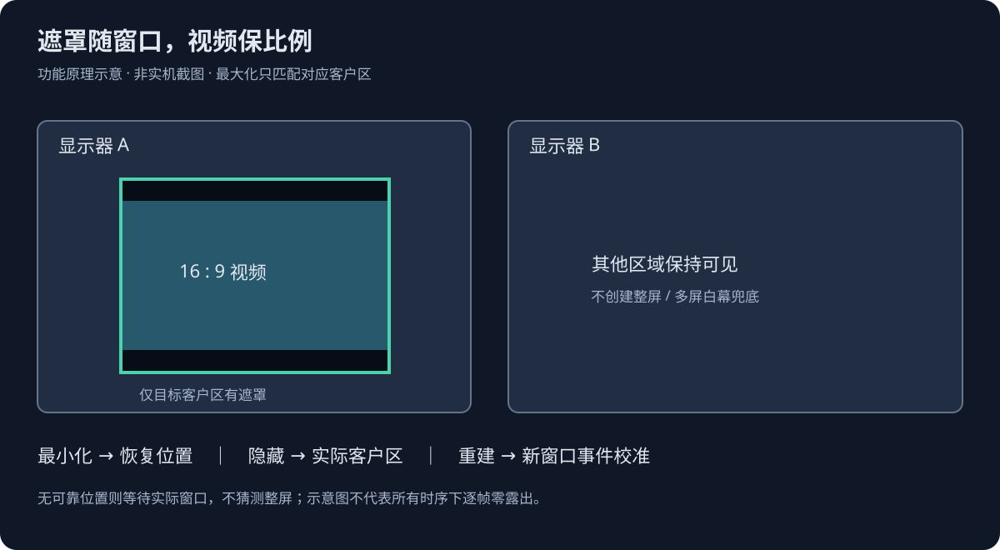
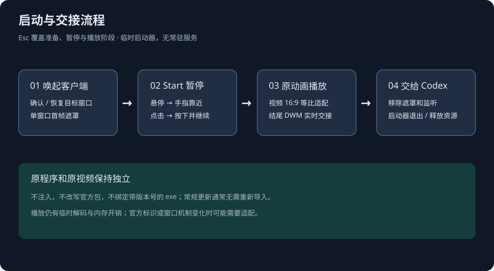

# Dragon Codex Boot Enhanced · 龙娘启动动画优化版

**在原版基础上优化，不是从零原创，也不是 OpenAI 官方工具。**

原版来自 **[yushua0808-cpu/dragon-codex-boot](https://github.com/yushua0808-cpu/dragon-codex-boot)**；感谢原作者和贡献者提供启动器、动画、DWM 交接及相关脚本。本仓库由 **knight458687810-code** 在此基础上优化 Windows 体验。保留 [MIT 许可证](LICENSE) 与 [媒体说明](media/MEDIA_NOTICE.md)，详细来源见 [UPSTREAM.md](UPSTREAM.md)。

> 本版只维护 Windows x64。macOS 用户请访问原项目。

## 它是什么？

一个独立启动器：播放随附的龙娘动画，同时唤起已安装的 Codex，最后把操作交还给真实客户端。**不是替代客户端、不修改官方程序包、不需要 API key。**


*上图是原视频的直接取帧，非实机界面截图。下方为功能原理示意，并非逐帧实测录像。*

## 本版主要优化

| 功能 | 行为 |
|---|---|
| 窗口自适应 | 跟随 Codex 实际客户区，不强行把 Codex 改成固定大小 |
| 比例不变 | 原视频始终完整等比显示为 16:9，异形窗口留边，不拉伸、不裁切 |
| Start 交互 | 出现 `codex start` 后暂停；悬停手指靠近，移开回退，点击后手指按下并继续 |
| 全程跳过 | 准备、暂停、播放过程中均可按 Esc |
| 最小化与关闭重开 | 区分普通恢复、最大化恢复、隐藏窗口和同进程重建窗口 |
| 窗口级遮罩 | 最多一个遮罩，只跟随目标窗口；不以全屏/多屏白幕兜底 |
| 降低干扰 | 低优先级、后台检测、静止降频、交接后退出，无常驻服务 |
| 更新兼容 | AppsFolder 应用标识启动，不硬编码带版本号的官方 exe 路径 |



## 下载与使用

1. 打开本仓库 [Releases](https://github.com/knight458687810-code/dragon-codex-boot-enhanced/releases/latest)。
2. 下载 `DragonCodexBoot-0.3.0-enhanced.1-win-x64-with-video.zip`，**完整解压**到长期保留的目录。
3. 双击 `DragonCodexBoot.exe`。等待 `codex start`，将鼠标移到按钮并点击；Esc 随时跳过。
4. 需要开始菜单入口时运行 `Install-Start-Menu.cmd`；取消这个独立入口用 `Uninstall-Start-Menu.cmd`。脚本只管理该独立 `.lnk`，不会自动固定任务栏。

**本版默认不自动替换已有快捷方式，也不扫描所有本地磁盘。** 使用官方原图标启动会绕过动画；请从本启动器或独立快捷方式打开。任务栏需自行取消旧固定并重新固定启动器。

进阶用户可手动运行 `Rescan-Entrypoints.cmd` 替换可识别的官方快捷方式。先阅读 [使用说明](docs/USAGE.md)；恢复用 `Restore-Original-Entrypoints.cmd`，不是前面的独立入口卸载脚本。

### 系统要求

Windows 10/11 x64、.NET Framework 4.8、已安装的 Codex 桌面客户端和 Windows 媒体组件。Windows N 等缺少媒体能力的系统需另行补齐。程序未签名，系统可能提示未知发布者；请核对下载来源和 SHA-256，不要关闭系统安全防护。

## 启动流程



正常 Codex 更新通常不需要重新导入视频；本工具和媒体独立于官方应用包。**如果官方改变应用标识、进程或窗口结构，仍可能需要更新配置或适配代码，不能承诺永久兼容。**

## 性能和边界

- 不注入、不改写 Codex，不设置开机自启；窗口事件和 Esc 监听只在启动过程中临时注册，交接后释放并退出。
- 播放期间仍有 WPF 解码与交互帧的临时 CPU/GPU/内存开销，不能承诺“零影响”。静态单元测试也不证明真实客户端流畅度。
- 无可靠窗口位置时等待实际窗口，而不是拿整屏遮罩遮住；此情况下不能保证每台机器都逐帧无露出。
- 原视频和手部热区按随附素材标定；替换视频后需重新标定，不是任意视频即插即用。
- DWM 缩略图不可交互，交接完成才可操作真实客户端。窗口就绪判定是启发式，不等于所有后台任务加载完毕。
- [测试范围与结果](docs/VALIDATION.md) · [配置与使用](docs/USAGE.md) · [第三方声明](THIRD_PARTY_NOTICES.md)

## 从源码构建

下载本仓库源码，在 Windows PowerShell 中执行：

```powershell
powershell.exe -NoProfile -ExecutionPolicy Bypass -File .\scripts\test.ps1
powershell.exe -NoProfile -ExecutionPolicy Bypass -File .\scripts\package.ps1
```

构建输出 `build/DragonCodexBoot/`，发布包输出 `dist/`。不需要 Node、Python 或 NuGet。构建脚本保留已有 build 配置；全新公开配置位于 `config/launcher.example.json`。

运行会在当前启动器目录产生 `logs/` 和 `.integration/`（位置、尺寸、DPI、快捷方式备份等）。**分享前不要把自己的这些运行记录打包上传**；本发布包不包含本机记录、聊天截图、官方提取图标或历史回滚目录。
